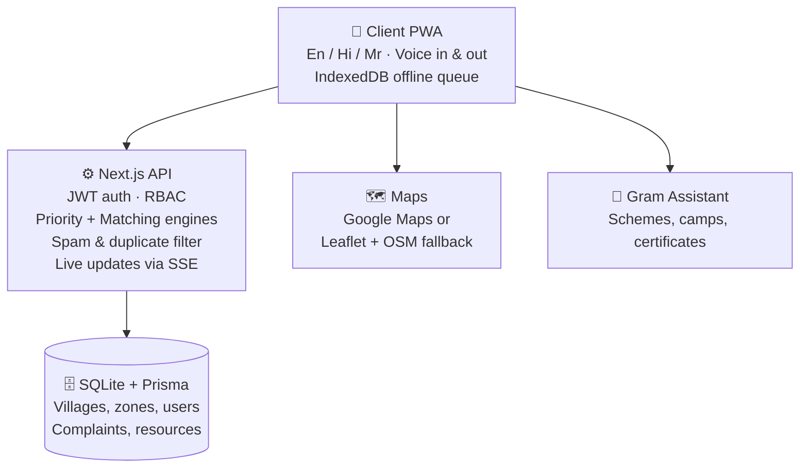

<div align="center">

# 🌉 GramSetu · ग्रामसेतू · ग्रामसेतू
### *The bridge between a village's needs and the people who can meet them.*

**PS 08 · Connecting Villages with Essential Services**

`English` · `हिन्दी` · `मराठी` &nbsp;|&nbsp; `Works offline` · `Speaks aloud` · `Listens to your voice`

</div>

---

## 🌾 It's 6:40 AM in a village

**Ananda** has two acres, a ready harvest, and no tractor.
**Ramesh**, two kilometres away, has a 45 HP tractor sitting idle in his yard.
**The Sarpanch** has no idea either of them exists in each other's world.

Meanwhile, a pipe has been leaking near the school for three days. Everyone has seen it. Nobody knows who to tell. And Ananda's mother, who cannot read or type, has been wanting to report it for a week.

> **The village isn't short of help. It's short of a bridge.**

**GramSetu is that bridge.**

---

## 🧭 What GramSetu does, in one breath

> Residents say what they need → the platform understands how urgent it is → routes it to the right department → matches it with hidden local resources → and proves it was fixed with a photo.

| 🗣️ **Speak** | ⚖️ **Prioritise** | 🤝 **Match** | 📸 **Prove** |
|---|---|---|---|
| Voice, text, photo, or someone filing on your behalf | An explainable score tells you *why* an issue is critical | Idle tractors, tankers and technicians find the people who need them | Resolution needs a proof photo, and the resident has the final word |

---

## 🎭 Four people. One platform.

| | Who | What they get |
|---|---|---|
| 🧑‍🌾 | **Resident**<br>*Ananda Jadhav* | Big icon cards for 10 problem types, voice input, SOS button, request a tractor or tanker, track status, confirm *"Is it fixed?"* |
| 🏛️ | **Sarpanch**<br>*Balasaheb Patil* | Full village view, 3-language notices, moderation queue, SOS command centre, Service Health Index |
| 🏢 | **Organisation**<br>*Jal Shakti Dept* | Only sees its own queue (water stays with water), SLA timers, before/after proof upload |
| 🚜 | **Provider / Volunteer**<br>*Ramesh Shinde* | Lists resources, gets smart-matched requests with a fit score, accepts or declines |

---

## 🔦 The ideas we're proud of

### 🧠 It explains itself
No black-box scores. Every critical ticket carries a plain-language reason:

> *"Severe hazard 5/5 · Impacts 200+ villagers in Zone B · Vulnerable groups: children, elderly · Open for 3 days"*

Matches explain themselves too:

> *"Very close (0.8 km) · 24x7 emergency availability · Panchayat verified"*

### 🧰 Hidden resources, finally visible
Villages already own tractors, pumps, tankers, electricians, halls and godowns. They're just invisible. GramSetu lists them, ranks the best three matches for any request, and flags gaps:

> *"Zone B: agricultural equipment demand is 7× local supply."*

It even asks the question every Panchayat should ask first: ***"Can the village solve this internally?"***

### 🔁 Accountability loop
```
SUBMITTED → VERIFIED → ASSIGNED → ACCEPTED → IN_PROGRESS → RESOLVED → CLOSED
                                                               │
                                          Resident says "No" ──┴──► REOPENED + escalated
```
A provider can't mark something resolved without a photo. A resident can reopen it. If a deadline is missed, it climbs the ladder: **Provider → Local Org → Sarpanch → District authority.**

### 🛡️ Built for people, not just phones
- 🔊 **Voice Help** on every screen reads instructions aloud
- 📴 **Offline queue**: complaints and SOS alerts wait safely and sync when signal returns
- 🕵️ **Anonymous complaints** with a tracking code, no name or phone number stored
- 🆘 **SOS**: hold for 2 seconds → live location goes to the Sarpanch and nearby volunteers, with quick-dial for 112, 1091, 181, 108, 100
- 🗺️ **Privacy-first map**: public pins snap to a ~200 m grid; exact location is only for the people who need it

---

## 🏗️ How it's wired



**Stack:** Next.js (App Router) · TypeScript · Tailwind CSS · Prisma · SQLite · Server-Sent Events · Web Speech API · Service Worker

---

## ⚡ Run it in 60 seconds

```bash
cd GramSetu
npm install            # also generates the Prisma client
npm run prisma:seed    # fills the village with realistic data
npm run dev            # → http://localhost:3000
```

**Demo logins** (or use the 1-click role switcher in the top bar). In demo mode the OTP appears on screen.

| Role | Mobile |
|---|---|
| Resident | `9876543250` |
| Sarpanch | `9876543210` |
| Organisation | `9876543220` |
| Provider | `9876543230` |

Run the tests: `npm test`

---

## 🎬 Watch the story unfold (demo script)

| # | Moment | What you'll see |
|---|---|---|
| 1 | 🌐 **Pick a language** | English, हिन्दी or मराठी on first launch |
| 2 | 🎤 **Ananda speaks** | Taps *Water*, talks, location auto-captured |
| 3 | 🚨 **Priority explained** | Ticket scores CRITICAL, routes to Jal Shakti, shows *why* |
| 4 | 📸 **Dept resolves** | Uploads a proof photo |
| 5 | 🎉 **Resident confirms** | "Is it fixed? Yes" → ⭐⭐⭐⭐⭐ → confetti |
| 6 | 📢 **Sarpanch alerts** | Emergency notice in 3 languages on the red ticker |
| 7 | 🆘 **SOS** | Hold 2 seconds, location sent, helplines shown |
| 8 | 🗺️ **Map & analytics** | Zones, toggles, Service Health Index, CSV export |
| 9 | 📴 **Go offline** | Queue a complaint, reconnect, tap *Sync Now* |

Automated version: `npx tsx scripts/test-live-e2e.ts`

---

## 🧮 Under the hood (the math, for the curious)

**Priority score**
`0.35·Urgency + 0.25·PeopleAffected + 0.20·Vulnerabilities + 0.15·TimeSensitivity + Aging + CategoryBoost`
Bands: 🔴 Critical ≥ 75 · 🟠 High ≥ 50 · 🟡 Medium ≥ 30 · 🟢 Low < 30

**Match score**
`Proximity 30% + Availability 25% + Suitability 20% + Reliability 15% + Response speed 10%`

**Duplicate detection**
TF-IDF + cosine similarity (> 0.55) within 350 m, grouped into clusters so one problem gets a *"+1 same for me too"* button instead of ten tickets.

> ⚙️ *These weights are sensible, configurable defaults. Next step: tune them with real Panchayat feedback.*

---

## 🔐 Privacy by design

Built around DPDP Act 2023 principles: consent notice, data minimisation, and a self-service **"Permanently delete my data"** option. Anonymous complaints store no identity fields.

---

## 🌱 Honest corner: limits & what's next

We'd rather tell you than have you discover it.

- 📊 Demo data is **seeded**, not from a live village yet
- 📶 It's a PWA, so it still needs a smartphone; **WhatsApp / SMS / IVR entry** is the natural next step
- 🗣️ Voice quality depends on the browser's speech support per language
- 🗄️ SQLite is perfect for demos; production would move to Postgres
- 🧪 Scoring weights need validation with real gram sevaks and Sarpanches

**Roadmap:** village pilot · WhatsApp bot · transport & facility-status flows · district-level dashboard

---

<div align="center">

### Made with 💚 for the 6 lakh+ villages that deserve a better bridge.

**Team GramSetu** · PS 08 Ideathon

</div>
