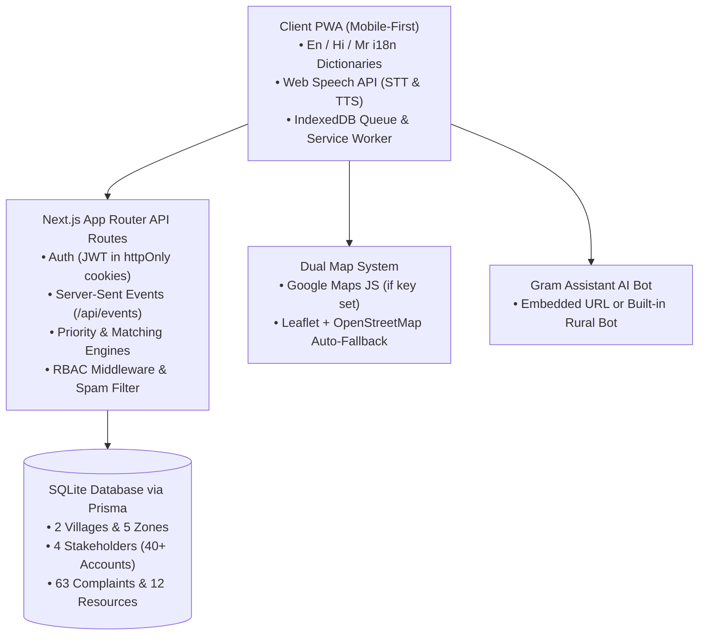

# GramSetu (ग्रामसेतू)
### Rural Needs & Resources Coordination Platform for Village Communities

GramSetu is a complete, working, demo-ready web application designed specifically for rural India's unique realities: multilingual accessibility, low literacy, intermittent or poor network connectivity, proxy reporting on behalf of elders, hidden local resources, and transparent grievance redressal with photo proof.

Built as an installable Progressive Web App (PWA) with Next.js (App Router), TypeScript, Tailwind CSS, Prisma, SQLite, and Server-Sent Events (SSE).

---

## 🏛️ System Architecture



---

## 🚀 Quick Start (Local Demo)

Use Node and npm from the same operating system that installed `node_modules` (Windows in the current workspace). SQLite needs no external database service, but it does need initialization:

```bash
# 1. Clone / Navigate to project
cd GramSetu

# 2. Install dependencies (runs Prisma generation automatically)
npm install

# 3. Create local configuration, initialize SQLite, and seed an empty database
npm run demo:setup

# 4. Start local development server
npm run dev
```

Open [http://localhost:3000](http://localhost:3000) in your browser.

`demo:setup` creates an ignored `.env` with a random session secret and a separate demo database when no `.env` exists. It preserves existing configuration and populated data; rerunning it does not reset complaints or users. Restart an already-running dev server if it does not pick up the new environment file.

Do not copy `node_modules` between Windows and WSL. Install separately if you intentionally change runtime platforms. No production readiness or legal-compliance guarantee is implied by the local demo setup.

---

## 👥 The 4 Stakeholder Roles & Demo Logins

GramSetu includes a **1-Click Role Switcher** on the top demo bar on every screen for instant evaluation, or you can log in using mobile OTP on the `/login` page:

| Role | Demo Name | Mobile Number | Responsibilities |
|---|---|---|---|
| **Resident** | Ananda Jadhav | `9876543250` | Reports grievances (voice/text/photo), raises anonymous complaints, sends SOS alerts, requests tractors/tankers, tracks status timeline, confirms resolution with 1-5 star ratings. |
| **Sarpanch (Admin)** | Balasaheb Patil | `9876543210` | Full village oversight, publishes emergency notices and health camps in 3 languages, moderates flagged/spam tickets, manages SOS alerts, monitors Service Health Index. |
| **Organization** | Jal Shakti Dept | `9876543220` | Segregated department queue (Water, Electricity, Roads, Health, Agriculture), accepts/rejects, manages SLA deadlines, uploads before/after resolution proof photos. |
| **Provider / Volunteer** | Ramesh Shinde | `9876543230` | Lists village resources (45HP Tractor), receives smart matched requests with proximity/fit score, accepts/declines, completes jobs. |

> **Local Demo Mode Login**: With `NEXT_PUBLIC_DEMO_MODE="true"`, `/login` displays and auto-fills the generated 6-digit OTP. The seeded four-role one-click login is also available; production deployments must configure real OTP delivery instead of enabling this demo shortcut.

---

## 🌟 Key Features Walkthrough

### 1. First-Screen Language Selector & Complete i18n
- On first visit, a full-screen accessible modal prompts the user to choose their preferred language: **English**, **हिन्दी (Hindi)**, or **मराठी (Marathi)**.
- Full JSON dictionary system (`src/lib/i18n/dictionaries/*.json`) covering all categories, statuses, error states, and buttons.
- Header language switcher persists choices in `localStorage` and `cookie`.
- Sarpanch notices can be authored in multiple languages; if a translation is missing, it cleanly falls back to the original text.

### 2. Live Top Notification Bar & Real-Time SSE
- Active ticker on every page showing live emergency warnings, Sarpanch announcements, active SOS alerts, and status changes.
- Bell icon displays unread count with a dropdown to mark as read.
- Real-time updates delivered instantly over Server-Sent Events (`/api/events`).

### 3. Problem Reporting (Resident)
- Big touchable icon cards for 10 rural categories: Water, Electricity, Roads, Transport, Health, Agriculture, Education, Sanitation, Women Safety, Other.
- **Voice Input**: Web Speech API listens and transcribes in the selected language.
- **Voice Read-back**: `speechSynthesis` reads aloud screens, statuses, and notices for low-literacy users.
- **Duplicate Support Button**: Automatic duplicate detection identifies nearby similar issues and offers a `+1 Same problem for me too` button instead of creating clutter.
- **Proxy Filing**: Sarpanch or volunteers can file complaints on behalf of elders or neighbors by entering their name and phone number.

### 4. Segregated Problem Solving & Priority Scoring Engine
- **Formula**:
  $$\text{Priority} = 0.35 \times \text{Urgency} + 0.25 \times \text{PeopleAffected} + 0.20 \times \text{Vulnerabilities} + 0.15 \times \text{TimeSensitivity} + \text{AgingPenalty} + \text{CategoryBoost}$$
- **Bands**: `CRITICAL` (score $\ge 75$), `HIGH` ($\ge 50$), `MEDIUM` ($\ge 30$), `LOW` ($< 30$).
- Explains **"Why is this critical?"** directly in the UI (e.g., *"Severe hazard 5/5 • Impacts 200+ villagers in Zone B • Vulnerable groups: children, elderly • Open for 3 days"*).
- Segregated queues: Jal Shakti only sees water issues; MSEDCL only sees electricity issues; Sarpanch sees everything.
- Multi-tier SLA timers with automatic escalation ladder: Local Provider $\rightarrow$ Local Org $\rightarrow$ Sarpanch $\rightarrow$ District/Block Authority.

### 5. Status Feedback & Resident Verification
- Visual lifecycle timeline: `SUBMITTED -> VERIFIED -> ASSIGNED -> ACCEPTED -> IN_PROGRESS -> RESOLVED -> CLOSED`.
- To mark an issue `RESOLVED`, the provider must upload a proof photograph.
- The resident then answers **"Is it fixed? Yes / No"** with a 1-5 star rating and feedback:
  - If **Yes**: status transitions to `CLOSED` and celebratory confetti fires!
  - If **No**: status automatically transitions to `REOPENED` and escalation level increments.
- Public **Resolved Feed** showcases verified before/after proof photos with privacy masking.

### 6. Hidden Resources & Smart Matching Engine
- Resource catalog: Equipment (tractors, pumps), Vehicles (water tankers, ambulances), Skilled Technicians (electricians, plumbers), Human Resources (doctors, tutors), and Facilities (community halls, grain godowns).
- **Match Score Algorithm**:
  $$\text{Score} = \text{Proximity (30%)} + \text{Availability (25%)} + \text{Suitability (20%)} + \text{Reliability (15%)} + \text{Response Speed (10%)}$$
- Ranks top 3 matching providers with transparent reasons (e.g., *"Very close (0.8 km) • 24x7 emergency availability • Panchayat verified"*).
- Provider can Accept or Decline (decline passes request to the next provider).
- **Resource Utilization Meter**: *"7 of 10 tractors idle this week"* + *"Can the village solve this internally?"* check.
- **Service Gap Detection**: Automatically detects supply/demand imbalances per zone (e.g., *"Zone B: Agricultural equipment demand is 7.0x local supply"*).

### 7. Confidential Anonymous Complaints (prototype privacy controls)
- Accessible without login. The complaint record does not attach an account, phone number, or device ID; transient in-memory rate limiting uses a salted hash and infrastructure/network logs are outside this app's control.
- Returns a random secure tracking code (e.g. `GS-ANON-7829-X`) for later status tracking.
- Abuse prevention via short-lived salted hash rate limiting (`checkRateLimit`).

### 8. Women's Safety & Emergency SOS
- Prominent SOS button on every page with a **2-second hold trigger**, vibration haptic feedback, and confirmation modal.
- Sends live location, timestamp, and alert to the Sarpanch and nearby safety volunteers over SSE.
- Direct quick-dial buttons: **112** (National Emergency), **1091** (Women Helpline), **181** (Women in Distress), **108** (Ambulance), **100** (Police).
- Instant share links for **WhatsApp** and **SMS** with prefilled coordinates.
- Offline fallback: queues in IndexedDB and attempts sync when the app is open and the connection returns; queued items are not delivered until sync succeeds.
- Dedicated SOS Command Center dashboard for authorized roles with response time tracking.

### 9. Live Village Map (Dual Engine)
- Falls back automatically to **Leaflet + OpenStreetMap** if `NEXT_PUBLIC_MAPS_API_KEY` is not provided.
- Village zones overlay: Zone A (North Ward), Zone B (Central Bazaar), Zone C (Farm Belts).
- Toggles: Grievances, Resources, Facilities (handpumps, health centre, school), Active SOS.
- **Privacy Obfuscation**: Public pins are snapped to a ~200m coarse grid. Exact GPS is restricted to the Sarpanch and assigned department.

### 10. Education Chatbot ("Gram Assistant")
- Floating widget and dedicated knowledge assistant.
- If `NEXT_PUBLIC_CHATBOT_URL` is set, embeds the external chatbot safely in an iframe.
- If empty or offline, provides an integrated rural AI knowledge bot answering questions about schemes, health camps, rationing, and certificates in English, Hindi, and Marathi with voice read-back.

### 11. Low-Literacy & Offline PWA Mode
- Voice Help button on every screen reads aloud current instructions.
- Service Worker (`public/sw.js`) caches app shell.
- IndexedDB (`src/lib/offline-queue.ts`) stores grievances, resource requests, and SOS alerts offline.
- Header displays offline banner and manual **"Sync Now"** button on reconnect.

### 12. Spam, Fake & Duplicate Detection
- **Text Similarity**: TF-IDF tokenization and Cosine Similarity ($> 0.55$) within 350m detects duplicate issues and groups them into clusters.
- **Spam Filtering**: Flags gibberish, unnatural character repetition (`aaaaaa`), promotional keywords (`casino`, `lottery`, `loan`), out-of-bounds coordinates, and low trust scores.
- Flagged items route to the **Sarpanch Moderation Queue** with detailed reasons.

### 13. Privacy & DPDP-aligned prototype controls
- Data minimization, consent copy, coarse public coordinates, and role-scoped responses are implemented as prototype controls.
- Self-service **"Delete My Data"** is available for the current account. This project does not claim legal compliance or replace a production DPDP assessment.

### 14. Analytics & Service Health Index
- **Village Service Health Index (0-100)**: Real-time composite score based on open critical issues, resolution speed, and resident satisfaction.
- **Seasonal Demand Alerts**: Monsoon drainage warnings (June-Sept), Harvest machinery surges (Oct-Nov), and Summer water tanker alerts (March-May).
- One-click **Export CSV** and printable Panchayat weekly report.

### 15. Scheme Navigator (Light)
- Needs-first guided wizard (*"I am a farmer needing irrigation"*) listing candidate schemes (PM-KUSUM, PM-Kisan, Ayushman Bharat, PMAY-G, Jal Jeevan Mission, Lakhpati Didi, PM Vishwakarma), required documents, and where to apply.

---

## 🧪 Automated Test Suite

Run the automated checks for the mathematical engines, access policy, isolated API handlers, and resource workflow:

```bash
npm test
```

The current suite includes 25 core engine assertions, 65 access-policy cases, 62 isolated API cases, and 9 isolated resource cases. The exact counts may grow as regression coverage is added; these tests do not replace browser/mobile/offline verification.
```text
🧪 Running GramSetu Core Engines & RBAC Test Suite...
  ✅ PASS: Band should be CRITICAL, got CRITICAL (Score: 100)
  ✅ PASS: Score should be >= 80, got 100
  ✅ PASS: Vulnerabilities should include pregnant
  ✅ PASS: Factor explanation should be generated
  ✅ PASS: Band should be LOW, got LOW (Score: 15)
  ✅ PASS: Haversine distance should be ~0.2km, got 0.2km
  ✅ PASS: Local verified tractor should rank #1
  ✅ PASS: Top score (98) should beat far score (59)
  ✅ PASS: High similarity expected for pipe leak texts, got 0.79
  ✅ PASS: Low similarity expected between pipe leak and streetlight, got 0.11
  ✅ PASS: Should detect duplicate issue
  ✅ PASS: Spam keywords and repetitive pattern should be flagged as spam
  ✅ PASS: Sarpanch can access all views
  ✅ PASS: Resident can manage own complaint
🎉 Core engine results: 25 / 25 assertions PASSED!
```

---

## 🎬 9-Step Demo Walkthrough

The following is a manual demo path. `scripts/test-live-e2e.ts` is a legacy mutation walkthrough and is **not** the automated proof of these behaviors; it is not safe to treat its printed checkmarks as offline or authorization verification.

```bash
# Use the browser click path below for the live demo.
```

| Step | Action | Screen / Feature |
|---|---|---|
| **1** | Pick Language | First visit full-screen modal or header selector (English, हिन्दी, मराठी). |
| **2** | Resident files voice complaint | Navigate to `/report`, tap category (Water), tap mic to speak, location is captured automatically. |
| **3** | Priority & Routing explained | Issue is auto-prioritized as `CRITICAL` (score 82/100) and routed to `JAL_SHAKTI`. Factor breakdown explains why. |
| **4** | Organization resolves with proof | Jal Shakti logs in (1-click on top bar), views assigned water queue, uploads resolution proof photo. |
| **5** | Resident confirms resolution | Resident receives top bar alert, answers *"Is it fixed? Yes"*, rates 5 stars with remarks. Confetti fires! |
| **6** | Sarpanch posts emergency alert | Sarpanch logs in, creates emergency rainfall notice with translations. Appears red on the top ticker. |
| **7** | Women's SOS alert triggered | Press & hold SOS button for 2 seconds. Transmits GPS coordinates to Sarpanch and volunteers. Quick dials shown. |
| **8** | Live map & analytics | View `/map` with zone boundaries and toggles; inspect `/analytics` for Service Health Index and CSV export. |
| **9** | Offline mode resilience (manual verification required) | In the presentation browser, disconnect Wi-Fi/data, queue a signed-in complaint/resource request or SOS, reconnect, click "Sync Now", and verify the UI changes from queued to submitted. |

---

## ⚙️ Environment Variables

See `.env.example`:

```ini
DATABASE_URL="file:./dev.db"
JWT_SECRET="replace-with-a-random-secret-of-at-least-32-characters"
NEXT_PUBLIC_MAPS_API_KEY="" # Leave empty for automatic Leaflet + OpenStreetMap fallback
NEXT_PUBLIC_CHATBOT_URL=""  # Leave empty for built-in Gram Assistant bot
NEXT_PUBLIC_DEMO_MODE="true"
```
